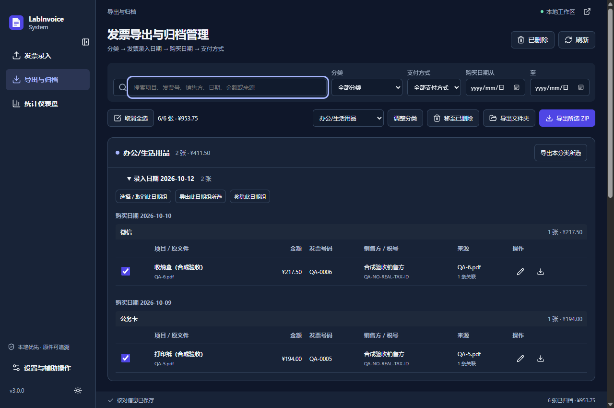

# LabInvoiceSystem 3.1

面向实验室成员与报账人员的本地发票工作台。Rust + Tauri 2 + React + TypeScript；Windows x64、macOS Intel 与 Apple Silicon。



## 使用与下载

- [安装包与更新日志](https://github.com/MIGO-OvO/LabInvoiceSystem/releases)
- [软件门户](https://migo-ovo.github.io/LabInvoiceSystem/)
- [使用说明](docs/user-guide.md) · [验收状态](docs/acceptance.md) · [新旧功能审计](docs/legacy-audit.md)
- [旧版完整存档](https://github.com/MIGO-OvO/LabInvoiceSystem-legacy)：独立保留全部历史、Tags 和 Releases。

**签名状态：** Tauri Updater 密钥已配置为 GitHub Secret。Windows 尚无 Authenticode 证书；macOS 缺少 Apple 发行证书和公证凭据，当前仅提供未公证预览构建，不能声称正式 macOS 分发或更新已完成。实际资产和平台状态见 Release 的 `release-security.json`。

## 工作流

导入原始 PDF/JPG/PNG 或多个 ZIP → 核对原件、分类、日期、金额和支付方式 → 归档 → 分类统计 → 导出原件、Excel 和 Manifest。报账人员再次接收多人提交的 ZIP，核对重复与模糊匹配后统一汇总。

- 办公/生活用品、实验用品为第一层分类；旧记录保留未分类。
- 兼容旧八字段 Excel ZIP、PascalCase JSON 和 `archive_data`。先备份再复制迁移，可撤销批次，原目录可继续供 Legacy 使用。
- SQLite WAL/FULL 事务、整数分金额、SHA-256 不可变原件、软删除恢复。
- 多 ZIP 独立处理，实际进度、失败明细、取消和重试；跨包/批次/归档去重，人工处理冲突。
- 导入后自动 OCR 默认开启，可在设置中关闭；批量上传明确授权，完整元数据优先保留，失败和取消可重试。凭据在 Windows Credential Manager / macOS Keychain，未授权不上传。
- 自定义标题栏、按内容宽度重排的核对区、隐藏滚动条与短时反馈动画；本地 PDF.js 高 DPI 预览，深浅与系统主题，分类和支付汇总、购买日期热力图。
- 官方 Tauri Updater 校验签名及签名中的版本，安装前排空操作与快照，失败可继续使用。

## 本地开发

需要 Node.js 24、Rust stable、目标平台的 Tauri 2 编译依赖；Windows 需 MSVC Build Tools 与 WebView2，macOS 需 Xcode Command Line Tools。

```sh
npm ci
npm run tauri dev
```

```sh
cargo fmt --all --check
cargo clippy --workspace --all-targets --locked -- -D warnings -A linker-messages
cargo test --workspace --locked
npm test
npm run build
```

Windows 真实 WebView 验收（使用独立合成数据目录，不模拟后端）：

```sh
cargo build -p lab-invoice-system --locked
npm run test:e2e
```

门户验证：

```sh
npx playwright install chromium
npm run test:portal
```

构建签名安装包：设置 `TAURI_SIGNING_PRIVATE_KEY` 和可选密码，然后运行 `node scripts/build-desktop.mjs --bundles nsis`（Windows），或 `--bundles app,dmg`（macOS）。私钥不得写入项目。

## 结构

| 目录 | 职责 |
| --- | --- |
| `crates/invoice-core` | 真实文件、ZIP/Excel、迁移、数据库、校验、统计、OCR |
| `crates/release-tools` | 与官方 Updater 同算法的发布签名、版本和篡改验证 |
| `src-tauri` | 原生命令、系统凭据、任务与更新安全锁 |
| `src` | React 桌面界面与本地 PDF 预览 |
| `portal` | 独立响应式产品门户，无发票上传功能 |
| `scripts` | 真实桌面验收、门户验收、资产清单与发布工具 |

[ZIP 格式与安全限制](docs/zip-limits.md) · [发布与密钥管理](docs/releasing.md)。MIT License。
