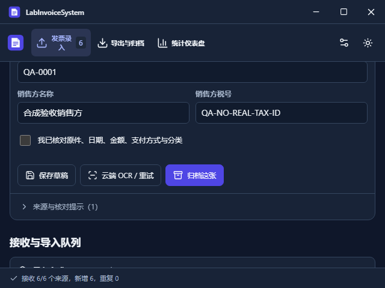
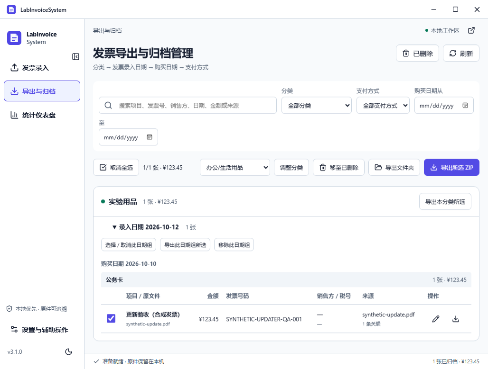

# 3.1.0 验收记录

2026-10-13，本轮自定义标题栏、自适应、隐藏滚动条、状态动画和默认自动 OCR 的 Windows 实际桌面验收通过。[3.1.0 已公开发布](https://github.com/MIGO-OvO/LabInvoiceSystem/releases/tag/v3.1.0)，Windows x64、macOS Intel / Apple Silicon 构建与安装检查全部通过。Windows 正式端点在线升级、公开安装包签名与校验和、门户正式域名验收通过；macOS 继续为未公证预览。

## 实现与验证

| 用户要求 | 实现 | 已执行验证 |
| --- | --- | --- |
| 自定义标题栏 | Windows 拖动、双击、最小化、最大化/还原、安全关闭；macOS 保留原生交通灯 | 实际 Windows 窗口按钮、双击、最小化/恢复和活动导入安全关闭 |
| 隐藏上下/横向滚动条 | 滚动保留在主区、原件和长列表中，外层视口固定 | 实际 640×480、800×600、1024×768；无页面/主区横向溢出；滚动后标题栏 top=0、height=40，根节点不滚动 |
| adapt 自适应 | 保留 Slate/Indigo 和原导航；核对主区与字段采用容器断点；短窗口操作可达 | 官方 Tauri SDK 设置原生窗口大小，并读取 inner_size/scale_factor 与 WebView CSS 尺寸交叉核对；核对与归档按钮可达 |
| 流畅动画 | 120/180/220ms 操作、页面、开关和模态反馈；160ms 模态退出 | 实际系统减少动态效果模式下页面动画为 none；七个代表状态 axe WCAG AA 零违规，无未捕获 JS 错误 |
| 默认自动 OCR | 设置 → 百度 OCR → 导入后自动 OCR；默认开启，旧配置兼容；批量授权明确 | 开关关闭/开启、跨重启持久化；旧单张上传授权不扩大为批量授权；无同意请求被拒绝，用量为 0 |
| OCR 队列与数据保护 | 串行真实百度请求、真实进度、取消、剩余草稿重试、成功结果与用量同事务保存 | Rust 队列取消/崩溃恢复、限额、网络失败/重试测试；完整和部分结构化资料保留，销售方修正范围正确 |
| 原有业务兼容 | 原有录入、预览、归档、分类、统计、ZIP 与更新准备流程保留 | 实际 PDF 翻页/缩放、手工核对、批量分类/归档、搜索/编辑、软删除/恢复、多 ZIP 无损回导和跨批次去重 |

技能实际应用与设计依据见 [实施计划](desktop-adapt-plan.md)、[桌面表面规范](../.impeccable/surfaces/src-app-tsx.md) 和 [DESIGN.md](../DESIGN.md)。技能选择沿用用户指定品牌和原有操作习惯，未要求额外人工选择。

## 自动化证据

- 本地 Rustfmt、Clippy、TypeScript/Vite 生产构建通过。
- Rust：19 项原有业务/安全工作流、5 项自动 OCR 元数据/设置测试、8 项 Tauri OCR 队列测试，共 32 项通过。
- Vitest：5 项通过。
- [定版完整 CI](https://github.com/MIGO-OvO/LabInvoiceSystem/actions/runs/38349163930) 的 quality 任务通过，19 个实际 Tauri 场景和 7 个代表状态的 axe AA 检查通过。录入截图等待合成 PDF 实际绘制完成，截图只使用明确标记的合成验收数据。
- [桌面原始报告](evidence/3.1.0/desktop.json)包含实际窗口尺寸、外层/主区滚动位置及所有场景结果。
- 同一完整 CI 四个任务全部通过；Windows NSIS 安装、生产 IPC/导航、官方被动更新和卸载 5 项通过；macOS 两架构的 DMG 安装、签名结构、原生程序运行与 SQLite 初始化各 3 项通过。

## 发行与在线更新

本轮使用独立开发分支，验证后通过 [PR #3](https://github.com/MIGO-OvO/LabInvoiceSystem/pull/3) 合并。`v3.1.0` 指向 `a7b324a56b5901335517c3b74eecdc7bbd1b15ed`；[合并后完整 CI](https://github.com/MIGO-OvO/LabInvoiceSystem/actions/runs/38350165574) 与 [三架构签名 Release](https://github.com/MIGO-OvO/LabInvoiceSystem/actions/runs/38350327350) 全部通过。

公开下载后的 13 项 SHA256、三平台资产映射与正式 `latest.json` 一致性通过。Windows NSIS 和两个 macOS 更新包的原件签名、认证版本、篡改拒绝及伪造版本拒绝均通过。生产更新清单只包含 Windows x64，macOS 包的 Updater 签名不代表 Apple 发行签名或公证。

| 平台 | 公开安装包 | 分发状态 |
| --- | --- | --- |
| Windows x64 | [NSIS 安装包](https://github.com/MIGO-OvO/LabInvoiceSystem/releases/download/v3.1.0/LabInvoiceSystem_3.1.0_windows_x64-setup.exe) | Tauri Updater 签名与真实在线升级通过；无 Authenticode |
| macOS Intel | [DMG](https://github.com/MIGO-OvO/LabInvoiceSystem/releases/download/v3.1.0/LabInvoiceSystem_3.1.0_macos_x64.dmg) | ad-hoc 未公证预览，不加入生产更新清单 |
| macOS Apple Silicon | [DMG](https://github.com/MIGO-OvO/LabInvoiceSystem/releases/download/v3.1.0/LabInvoiceSystem_3.1.0_macos_arm64.dmg) | ad-hoc 未公证预览，不加入生产更新清单 |

### Windows 公开 3.0.1 → 3.1.0 升级

[正式端点升级 CI](https://github.com/MIGO-OvO/LabInvoiceSystem/actions/runs/38353351606) 在全新 Windows runner 上安装公开 3.0.1，再使用官方插件、生产公钥与公开 GitHub `latest.json` 升级，未使用替代密钥或测试更新服务器。9 项通过：

1. 旧版创建并归档真实合成发票。
2. 官方插件发现公开 3.1.0。
3. 稍后提醒持久化。
4. 跳过版本持久化，手动检查可以覆盖跳过。
5. 安装完成后，新版原生进程自动启动；精确核对安装路径与 ProductVersion 为 3.1.0。
6. 旧设置迁移后自动 OCR 默认为开启，原有上传授权保持关闭。
7. 实际下载、签名校验、安装与生产版本重启。
8. 原件字节、发票身份、来源关联、分类、金额和原有设置完整保留。
9. 更新前真实数据库备份存在。

检查边界：NSIS 经 Explorer 自动启动的新版进程没有继承 WebView2 CDP 诊断参数。脚本先确认该原生进程自动启动，再仅重启远程 CI 中自己安装的 QA 程序，附带诊断参数检查持久数据；此步骤明确记录在报告的 `nativeAutoRestart` 和 `diagnosticRestart` 中。自动重启结论来自原生进程证据，重启后的数据结论来自诊断连接。用户本机正在运行的应用与真实归档未参与此次升级检查。

原始报告见 [windows-public-upgrade.json](evidence/3.1.0/windows-public-upgrade.json)。下图为实际升级后窗口，仅含明确标记的合成发票。

### 产品门户

[正式门户](https://migo-ovo.github.io/LabInvoiceSystem/)已部署 3.1.0，[Pages 工作流](https://github.com/MIGO-OvO/LabInvoiceSystem/actions/runs/38351360073)通过。正式域名 11 项验收通过：当前公开版本元数据、六种视口/主题、200% 文字放大和三个真实下载 URL；六个代表状态 axe WCAG AA 零违规，无横向溢出、控制台或网络错误。键盘焦点、主题持久化、安装说明深链及当前更新日志同时检查。门户三张产品图为真实 3.1.0 Tauri 截图，均使用合成数据。

证据见 [pages-live.json](evidence/3.1.0/pages-live.json)、[portal-local.json](evidence/3.1.0/portal-local.json) 和 [公开发行报告](evidence/3.1.0/public-release.json)。自动无障碍检查不替代完整人工屏幕阅读器测试。

## 验收边界

- 用户已反馈百度 OCR 测试正常。本轮 Agent 自动化只用合成资料验证业务、队列和明确授权边界，未上传用户真实发票；网络成功/失败的队列单元测试使用注入响应，不替代用户的实际百度服务测试。
- macOS Intel / Apple Silicon 的安装启动检查不替代交互式 WKWebView、真实用户设备或 Gatekeeper 人工验收。
- Apple 发行签名与公证凭据仍缺失；macOS 继续为 ad-hoc 未公证预览，不加入正式 Updater 清单。所需 Secrets 见 [发行说明](releasing.md)。
- Windows 未配置 Authenticode 证书；Tauri Updater 数字签名独立验证安装包完整性，首次安装可能有 SmartScreen 提示。
- 本轮 UI 与自动 OCR 交付不代表原 Goal 的完整双平台正式签名、公证与更新目标已解除上述客观阻塞。
